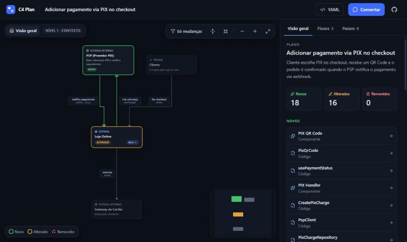
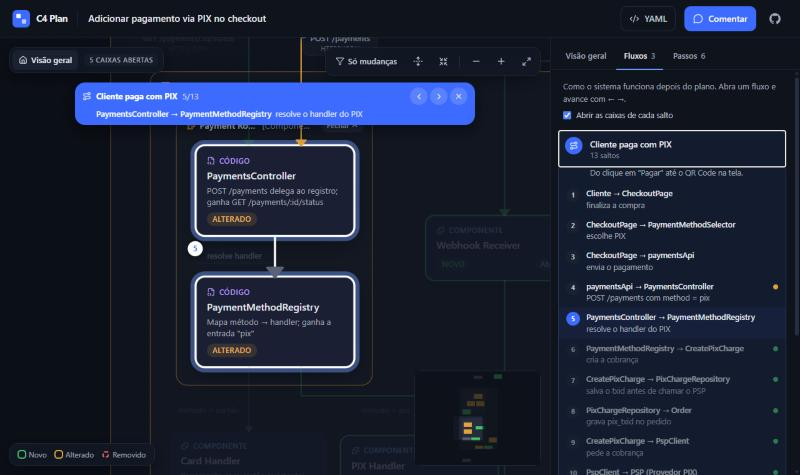

# Blueroll

**English** · [Português](README.pt-BR.md)

A skill for coding agents (Claude Code, Cursor and the like) that turns a plan into a navigable diagram: the blueprint you review before the build. For software, the diagram follows C4. Before the AI executes anything, you see what the plan creates, changes and removes, follow the flows hop by hop, ask about any piece and approve in the chat.

The same skill also documents an existing system, for onboarding or for getting to know a repository. And it is not only architecture: with another notation it draws a business process, infrastructure or a domain model, or uses box types you declare.

> Formerly **C4 Plan**. Old links still open.

> The skill instructions (`SKILL.md`) are written in Portuguese; the agent follows them in any language, and the viewer, brief and messages come in English, Portuguese or Spanish.



**See an example:** open https://gustavorana25.github.io/c4-model-skill/ and pick one of the examples (two-factor login in C4, AWS building blocks, a delivery app journey). They open in the language of the interface.

## What you get

- **A diagram that goes from context down to code.** Systems, containers, components and files, with what is new, changed and removed in color. Everything starts collapsed at the context level, and you open only what you want to see.
- **Hop-by-hop flows.** How the system works after the plan ("Login with the authenticator app", "Too many wrong codes"). You step through with ← → and the diagram drills down to the level of each hop.
- **Plan steps linked to the architecture.** Each step shows which elements it creates or changes.
- **Explicit constraints.** What the implementation must respect ("idempotency by txid", "migration without table lock").
- **Other notations.** `processo` (lanes, steps, decisions), `infra` (cloud, region, network, cluster), `dominio` (contexts, aggregates, events), `jornada` (user journey to a feature), `livre`, and custom types in the YAML. See section 1b of [`SKILL.md`](skills/blueroll/SKILL.md).
- **English, Portuguese and Spanish.** The viewer follows your browser's language (with a switcher in the header). The YAML's `lang` field sets the language of the brief and the validation messages.
- **A brief for execution.** After you approve, the AI generates a Markdown file with the structure and constraints and follows it while implementing.



## Quick start (no install)

To try it in a single conversation, paste this into your agent after it has written a plan:

```text
Download the Blueroll skill into a temporary folder, keeping its structure (SKILL.md, scripts/arch_url.py, scripts/messages.py, schema/arch.v1.json, schema/notations.json, schema/notations.i18n.json), from https://raw.githubusercontent.com/gustavorana25/c4-model-skill/main/skills/blueroll/. Read the whole SKILL.md and follow it to show me the plan's architecture.
```

Ask it to **download** the files, not just read the URL: the link is generated by `arch_url.py`, and web-reading tools may hand the agent a summary instead of the full instructions. The agent will ask permission to download and run the script. It only lasts for that conversation; to use it always, install it.

## Install

Copy the [`skills/blueroll/`](skills/blueroll/) folder into your agent's skills folder. In Claude Code, for example, use `.claude/skills/` in the project or `~/.claude/skills/` for all projects:

```bash
git clone https://github.com/gustavorana25/c4-model-skill.git && cp -r c4-model-skill/skills/blueroll ~/.claude/skills/
```

Requirement: Python 3 with PyYAML (`jsonschema` is optional). You don't need to install the viewer: links open the published version.

## How to use

**To review a plan.** Ask for the plan as usual and, before approving, ask to see the architecture:

> show me the plan's architecture

The AI replies with a link. Open it, look around and, to ask a question or request a change, press **C** (or **Comentar**), click the cards and type. When everything looks right, approve in the chat ("approved", "go ahead"). Only then does the AI execute.

**To document an existing system:**

> document this repository's architecture

The AI reads the code and produces the same diagram, without status or steps, with the system's main flows. It can also generate the documentation as Markdown to keep versioned in the repository.

## How it works

```
plan ─► arch.yaml ─► link ─► you look and comment ─► AI adjusts the YAML ─► ok in chat ─► brief ─► execution
```

1. The AI describes the plan's architecture in a `<plan>.arch.yaml` file. Not the whole system: only what the plan touches plus the minimum context to understand it.
2. The skill's script validates the YAML and generates the link. The whole plan goes compressed in the URL's `#hash`, which **is never sent to the server**: the viewer is a static page and stores nothing.
3. You open the link. If the agent has a built-in browser (Claude Code's browser pane, Cursor's, Claude in Chrome), it opens the diagram there and listens to your comments while you interact. Without one, the comment button copies ready-made text to paste in the chat.
4. **The chat is the source of truth.** The viewer only displays. Answers come in the chat, and every change goes through the YAML, which produces a new link.
5. When you approve, the AI generates the brief (`<plan>.arch.md`) and executes following the structure and constraints. If it needs to step outside them, it stops and asks.

The full instructions the AI follows are in [`skills/blueroll/SKILL.md`](skills/blueroll/SKILL.md).

## Development

The viewer code, link format, tests and publishing are covered in [`viewer/README.md`](viewer/README.md).

## License

[MIT](LICENSE)
