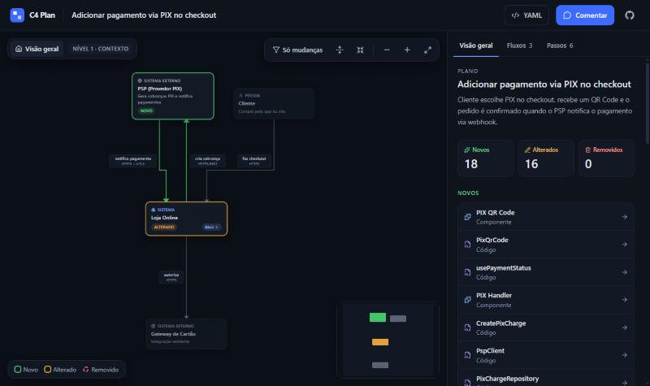
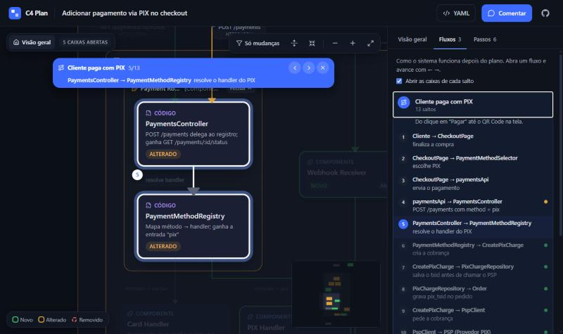

# C4 Plan

[English](README.md) · **Português**

Uma skill para agentes de código (Claude Code, Cursor e afins) que transforma um plano de implementação num diagrama de arquitetura navegável, no estilo C4. Antes de a IA executar, você vê o que o plano cria, altera e remove, segue os fluxos salto a salto, pergunta sobre qualquer peça e aprova no chat.

A mesma skill também documenta um sistema que já existe, para onboarding ou para entender um repositório.



**Veja um exemplo:** abra https://gustavorana25.github.io/c4-model-skill/ e clique em **Ver exemplo (PIX)**.

## O que você recebe

- **Diagrama que desce do contexto até o código.** Sistemas, containers, componentes e arquivos, com o que é novo, alterado e removido em cores. Tudo começa fechado no nível de contexto, e você abre só o que quer ver.
- **Fluxos salto a salto.** Como o sistema funciona depois do plano ("Cliente paga com PIX", "QR Code expira"). Você avança com ← → e o diagrama desce até o nível de cada salto.
- **Passos do plano ligados à arquitetura.** Cada passo mostra quais elementos ele cria ou altera.
- **Restrições explícitas.** O que a implementação precisa respeitar ("idempotência por txid", "migração sem lock de tabela").
- **Um brief para a execução.** Depois da sua aprovação, a IA gera um Markdown com a estrutura e as restrições e segue esse documento enquanto implementa.



## Uso rápido (sem instalar)

Para experimentar numa conversa só, cole isto no seu agente depois que ele escrever um plano:

```text
Baixe a skill C4 Plan para uma pasta temporária, mantendo a estrutura (SKILL.md, scripts/arch_url.py, schema/arch.v1.json), a partir de https://raw.githubusercontent.com/gustavorana25/c4-model-skill/main/skills/c4-plan/. Leia o SKILL.md inteiro e siga as instruções para mostrar a arquitetura do plano.
```

Peça para **baixar** os arquivos, não só para ler a URL: quem gera o link é o `arch_url.py`, e as ferramentas de leitura da web podem entregar ao agente um resumo em vez das instruções completas. O agente vai pedir permissão para baixar e rodar o script. Vale só para aquela conversa; para usar sempre, instale.

## Instalar

Copie a pasta [`skills/c4-plan/`](skills/c4-plan/) para a pasta de skills do seu agente. No Claude Code, por exemplo, use `.claude/skills/` no projeto ou `~/.claude/skills/` para todos os projetos:

```bash
git clone https://github.com/gustavorana25/c4-model-skill.git && cp -r c4-model-skill/skills/c4-plan ~/.claude/skills/
```

Requisito: Python 3 com PyYAML (`jsonschema` é opcional). O viewer não precisa ser instalado, porque os links abrem a versão publicada.

## Como usar

**Para revisar um plano.** Peça o plano normalmente e, antes de aprovar, peça para ver a arquitetura:

> mostra a arquitetura do plano

A IA responde com um link. Abra, navegue e, se quiser perguntar ou pedir mudança, aperte **C** (ou **Comentar**), clique nos cards e escreva. Quando estiver tudo certo, aprove no chat ("aprovado", "pode seguir"). Só então a IA executa.

**Para documentar um sistema que já existe:**

> documenta a arquitetura desse repositório

A IA lê o código e gera o mesmo diagrama, sem status nem passos, com os fluxos principais do sistema. Ela também pode gerar a documentação em Markdown para ficar versionada no repositório.

## Como funciona

```
plano ─► arch.yaml ─► link ─► você olha e comenta ─► IA ajusta o YAML ─► ok no chat ─► brief ─► execução
```

1. A IA descreve a arquitetura do plano num arquivo `<plano>.arch.yaml`. Não é o sistema inteiro: só o que o plano toca e o contexto mínimo para entender.
2. O script da skill valida o YAML e gera o link. O plano inteiro vai comprimido no `#hash` da URL, que **não é enviado ao servidor**: o viewer é uma página estática e não guarda nada.
3. Você abre o link. Se o agente tiver um navegador embutido (o painel de browser do Claude Code, o do Cursor, Claude in Chrome), ele abre o diagrama lá e escuta seus comentários enquanto você mexe. Sem isso, o botão de comentar copia um texto pronto para colar no chat.
4. **O chat é a fonte da verdade.** O viewer só mostra. As respostas vêm no chat, e toda mudança passa pelo YAML, que gera um link novo.
5. Quando você aprova, a IA gera o brief (`<plano>.arch.md`) e executa seguindo a estrutura e as restrições. Se precisar sair delas, ela para e pergunta.

As instruções completas que a IA segue estão em [`skills/c4-plan/SKILL.md`](skills/c4-plan/SKILL.md).

## Desenvolvimento

O código do viewer, o formato do link, os testes e como publicar estão em [`viewer/README.md`](viewer/README.md).

## Licença

[MIT](LICENSE)
